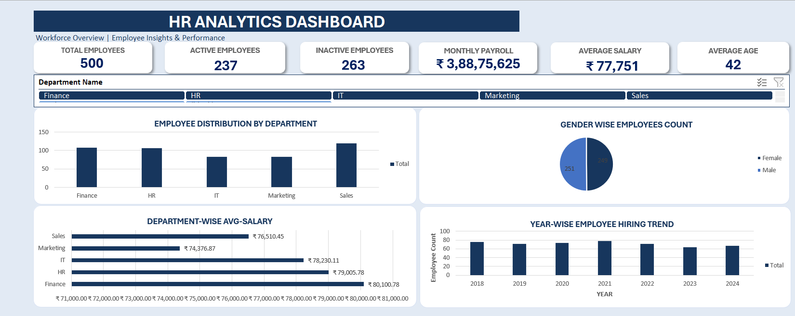

# HR Analytics Dashboard 2.0 | Microsoft Excel

## Project Overview

The **HR Analytics Dashboard 2.0** is an interactive Excel dashboard designed to analyze employee data and present meaningful HR insights through KPIs, PivotTables, Pivot Charts, and interactive slicers.

The dashboard helps users understand workforce distribution, employee status, salary expenditure, and hiring trends in a simple and visual format.

## Objectives

- Analyze employee data and identify useful HR insights.
- Monitor active and inactive employees.
- Understand department-wise employee distribution.
- Analyze salary expenditure across departments.
- Track employee hiring trends over time.
- Present key HR metrics through an interactive dashboard.

## Tools & Technologies

- Microsoft Excel
- PivotTables
- Pivot Charts
- Excel Slicers
- Excel Formulas
- Data Cleaning and Validation
- Dashboard Design and Data Visualization

## Key Performance Indicators (KPIs)

The dashboard includes six important HR metrics:

1. **Total Employees** – Total number of employees.
2. **Active Employees** – Number of currently active employees.
3. **Inactive Employees** – Number of inactive employees.
4. **Total Payroll** – Total salary expenditure.
5. **Average Salary** – Average employee salary.
6. **Average Age** – Average age of employees.

## Dashboard Features

- Interactive department slicer.
- Dynamic KPI cards.
- Department-wise employee distribution.
- Active vs. inactive employee analysis.
- Year-wise employee hiring trends.
- Department-wise salary expenditure.
- Interactive Pivot Charts connected to the dashboard.

## Dashboard Preview

    

## Project Workflow

1. **Data Preparation:** Reviewed the employee dataset and checked data quality.
2. **Data Cleaning:** Validated employee IDs, departments, salaries, ages, and employment status.
3. **Data Analysis:** Used PivotTables to calculate HR metrics and summarize employee information.
4. **Data Visualization:** Created Pivot Charts to present workforce and salary trends.
5. **Dashboard Development:** Designed an interactive dashboard with KPI cards and department slicers.
6. **Validation:** Tested slicer functionality and checked whether KPIs and charts updated dynamically.

## Business Questions Addressed

- How many employees are there in the organization?
- How many employees are active and inactive?
- Which department has the highest number of employees?
- What is the total salary expenditure?
- Which department contributes the most to payroll?
- How has employee hiring changed over the years?

## Skills Demonstrated

- Data Cleaning and Validation
- Exploratory Data Analysis
- HR Data Analysis
- PivotTable and PivotChart Development
- KPI Reporting
- Interactive Dashboard Creation
- Data Visualization

## Project Structure

```text
HR-Analytics-Dashboard/
│
├── HR_Analytics_Dashboard.xlsx
├── Dashboard_Screenshot.png
└── README.md
```

## Conclusion

This project demonstrates how Microsoft Excel can be used to transform raw HR data into an interactive dashboard that supports workforce analysis and data-driven decision-making.

---

**Project Type:** Data Analytics | HR Analytics  
**Tool:** Microsoft Excel  
**Created by:** Sudhanshu Ranjan